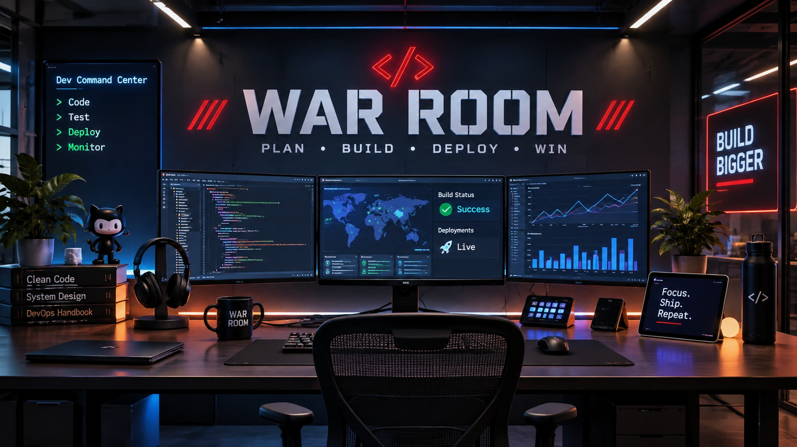

# War Room

A lightweight, local-only web app that tracks Azure DevOps work items and GitHub
issues/pull requests you have touched: currently assigned, previously assigned,
created, edited, commented, or mentioned in a comment. Connect one or both sources.

## Setup

### Download for Windows

1. Download `WarRoom-windows-x64.zip` from the
   [latest release](https://github.com/thatnavguy/War-Room/releases/latest).
2. Extract the full ZIP to a folder where you want to keep War Room.
3. Double-click **War Room.exe**. It starts the local server and opens your browser.
4. Keep the console window open while you use War Room. Press Ctrl+C in that
   window to stop it.

The ZIP includes everything needed to run War Room. You do not need to install
Node.js or run `npm install`. Your settings and tracked work stay in the extracted
folder. When updating, extract the new release over the same folder and keep
your `.env` file and `data` folder.

### Run from source

On Windows, double-click `start-dashboard.bat` to start the dashboard and open it
in your browser. The first run installs the required packages.
If startup fails, check `data\dashboard-error.log` and `data\dashboard-output.log` for details.

To create or update the desktop shortcut, double-click `add-desktop-shortcut.bat`.
Run it again to refresh the shortcut name and icon.
Then use **War Room** on your desktop to start the dashboard.
The installer uses your Windows desktop folder, including desktops managed by OneDrive.
Keep this project folder in place. If you move it, remove the old shortcut and run the installer again.

1. `npm install`
2. `npm start` → http://localhost:4073
3. Open the **setup page** (linked on the dashboard, or http://localhost:4073/setup.html)
   and connect your sources — either or both:
   - **Azure DevOps**: organization URL (e.g. `https://dev.azure.com/myorg`) and a
     Personal Access Token with **Work Items (Read)** scope.
   - **GitHub**: a personal access token (classic with `repo` scope, or fine-grained
     with **Issues** and **Pull requests** read access). Optionally limit sync to
     specific `owner/repo` repositories or point at a GitHub Enterprise host.

Prefer files? You can also copy `.env.example` to `.env` and fill it in manually.
The setup page writes to the same `.env` file.
Settings saved in this project's `.env` file take priority over inherited environment variables.
Restart the dashboard after editing the file manually.

## Optional settings (.env)

| Setting | Default | Purpose |
|---|---|---|
| `PROJECTS` | all projects | Comma-separated project names to limit Azure DevOps sync scope |
| `GH_TOKEN` | — | GitHub personal access token; enables the GitHub source |
| `GH_REPOS` | all repos you are involved in | Comma-separated `owner/repo` entries to limit GitHub sync scope |
| `GH_HOST` | github.com | GitHub Enterprise host |
| `ADO_AUTO_SYNC_MINUTES` | 0 (off) | Minutes between automatic Azure DevOps syncs |
| `GH_AUTO_SYNC_MINUTES` | 0 (off) | Minutes between automatic GitHub syncs |
| `PORT` | 4073 | Local server port |
| `STALE_DAYS` | 14 | Days without update before an open item assigned to you "needs attention" |
| `LOOKBACK_DAYS` | 365 | How far back the first sync deep-scans for your edits/comments |
| `DISCOVERY_DAYS` | 30 | Show open items updated within this many days in Discovery Room (1–3650) |

## Usage

- Open **Discovery Room** to browse recent, open items already stored on this computer
  with no recorded assignment, creation, edit, comment, or mention involving you.
  It does not fetch extra items from either source.
  It starts with items updated within the last 30 days.
  Change **Settings → General → Discovery window (days)**, save, then reload Discovery Room to apply the new window.
  Older items stay stored but do not appear in Discovery Room.
  Search and filter by source, project, priority, label, type, or state.
  Use **Load more items** to see results beyond the first 200.
  Discovery Room keeps its filters and saved views separate from Briefing Room.
  Opening an item or writing private notes does not record source involvement or add it to Briefing Room.
  When a later sync records your involvement, the item leaves Discovery Room and appears in Briefing Room.
  Discovery is most useful for Azure DevOps, which also stores recently changed items beyond your own work.
  GitHub sync searches for items involving you, so its Discovery Room results may be empty.

- Click **Sync** to incrementally fetch new/changed items. The first sync is the
  heaviest; later syncs only fetch what changed since the watermark.
  If sync reports an issue, the dashboard shows the error details.
  The server also logs them to `data\dashboard-error.log` when started with the Windows launcher.
- The saved-view dropdown includes two built-in **preset views** that filter the work list:
  - **Daily digest** shows open items due today, overdue, or changed today.
  - **Needs attention** shows open items assigned to you with no update for the configured number of days.
    The **need attention** summary count uses the same rule; choose it to open the preset.
  Presets set the **Focus** filter, and you can adjust the other filters afterwards.
  Presets cannot be deleted, and your own views cannot reuse a preset's name.
- Search by ID, title, tag, project, or state — results filter as you type.
  Press `/` to focus search, Esc to clear.
- Filter by project, type, state, priority level, label, and assignment to you.
  Iteration and From/To filters are no longer shown. Older saved views ignore those removed filters.
- The work list shows **Due date** instead of Iteration.
  Dates due today are amber. Overdue dates are red. Both include a text label.
  Future dates use normal text. Items without a due date show a dash.
  Dates are compared using your computer's local calendar day.
  Restart the dashboard and sync once after upgrading to load due dates for existing tracked items.
- Save a set of search and filter settings as a named view, then choose it to use those settings again.
  Saved views stay in this browser and appear below the preset views. Select a view and choose **Delete view** to remove it.
- Labels (Azure DevOps tags) appear beneath titles in the list and in item details.
  The **Label** filter lists labels from touched or mentioned work and matches a whole label, not part of its name.
  The Project filter only lists values from items you have touched or been mentioned on, including closed items.
  Search and filters stay selected when you return from a work item or reload the page in the same tab.
  Use **Clear filters** to reset them.
- Priority level appears in item details, the work-item list, and its own dashboard filter.
  Azure DevOps uses the custom **Priority Level** field when available, or its standard numeric **Priority** otherwise.
  Sync once after upgrading to fetch priorities for previously tracked items. Missing priorities display as a dash.
- On desktop, the navy table header stays visible as you scroll through the work-item list.
- Open an item to see exactly why it's tracked (assigned / created / edited /
  commented / mentioned) and jump to it in Azure DevOps.
- Use the external-link icon beside a work-item ID to open Azure DevOps in a new tab.
  The ID and title still open War Room details. Your list filters stay unchanged.
- Choose the eye-off **Hide** icon at the right edge of a row to remove an unrelated item from Briefing Room.
  The confirmation includes **Undo** to bring it straight back.
  Hide preferences are saved in the local database. Azure DevOps is not changed.
  Use **Visibility: Hidden items** and **Restore** to bring an item back.
  Items assigned to you or whose latest comment explicitly @mentions you cannot be hidden.
  These conditions override an earlier hide preference after syncing.
  If neither condition applies later, the hide preference takes effect again.
  Restart the dashboard and sync once after upgrading to check the latest comments on tracked items.
- Actual **@mentions of your identity** bring open items into Briefing Room after syncing.
  Plain text containing your name does not count as a mention.
  The first sync after this update scans comments on items changed within the configured lookback period.
  If a scan fails, the sync checkpoint stays unchanged so the next sync retries.
  Your name uses an amber highlight in assignment fields, comment authors, and structured @mentions.
- Screenshots in descriptions and comments appear inline. The local server loads
  them with your saved Azure DevOps token; the token is never sent to the browser.
  PNG, JPEG, GIF, WebP, and BMP images up to 20 MB are supported.
- **Attachments** loads the work item's current files without another sync.
  Image files have inline previews. File links open in Azure DevOps, where you may need to sign in.
  File sizes appear when Azure DevOps supplies them. Upload or remove files in Azure DevOps.
- Select **Comments only** beside **Comments & history** to hide field changes
  and revisions without comments. Clear it to see the full history again.
- Use the section menu at the top of a work item to jump to **Description** or **Comments & history**.
  The menu and **Briefing Room** back link stay visible as you scroll. The menu only shows sections that are available.
- **Related links** shows existing linked work items, commits, pull requests, and web links, grouped by type.
  Links load live from Azure DevOps; no sync is needed. Attachments remain in their separate section.
  Azure DevOps Git links open directly. GitHub artifact links use an internal repository ID,
  so they explicitly open the source work item in Azure DevOps instead of guessing a GitHub URL.
  Add or edit links in Azure DevOps; War Room remains read-only.
- Choose **Visibility: Closed items** to find tracked closed or removed items, including hidden ones.
  Search and the other filters still apply. The open-work summary and focus views do not include closed items.

Data lives in `data/devops-center.db` (SQLite). Nothing leaves your machine
except read-only calls to your connected Azure DevOps org and GitHub host.

## Work sources

Azure DevOps and GitHub are both supported and can be connected at the same time.
The **Briefing Room** feed stays unified: a **Source** filter appears once multiple sources
are connected, each row links out to its own source, and **Sync now** syncs every
connected source in one pass.

To sync automatically, open **Settings** and set **Auto-sync interval (minutes)**
under each connection. For example, use 5 minutes for Azure DevOps and 15 for GitHub.
Enter a whole number from 1 to 1440, or 0 to turn off that source's schedule.
Save that connection's settings to apply the interval without restarting.

Auto-sync runs while the local server is running, even when your browser is closed.
The first run starts after the interval. It skips a source if that source is already syncing.
Refresh **Briefing Room** to see newly synced items. Errors appear in the server terminal
with an `auto-sync` prefix, and the next scheduled run tries again.

GitHub issues and pull requests are discovered with the search API (`assignee:@me`,
`author:@me`, `involves:@me` since the last watermark).
Each search runs separately for `is:issue` and `is:pull-request`, as GitHub requires.
Both types appear in the same feed. An item is unique by provider,
source scope, and external ID. For Azure DevOps, the scope is the organization URL;
for GitHub it is the host plus repository (`github.com/owner/repo`), so issue numbers
never collide across repositories. Sync checkpoints and profile names are kept
separate for each provider and scope.

GitHub notes:

- The type is shown as **Issue** or **Pull Request**; labels map to the label filter.
- Comments and history come from issue comments and timeline events.
- Markdown bodies and comments render as safe HTML (headings, lists, bold, code,
  links). Images embedded in markdown are not loaded.
- "Edited by me" is not tracked: the GitHub API does not expose it without
  scanning every item's full timeline.
- Attachments and related links are Azure DevOps-only; the authenticated
  screenshot endpoint never proxies GitHub URLs.

To add another provider, register its adapter in `server/providers.js`. It must supply
its ID, display name, connection check, scope, sync functions, history loader, and safe
rich-text renderer. Save normalized items through `server/store.js` with `provider`,
`source_scope`, `external_id`, and an `is_closed` boolean; use the local ID returned by
`saveItem()` when recording touches. History must return the existing
`{ rev, date, by, comment, changes }` entries with safe HTML comments.
Unknown providers fail explicitly rather than returning empty results.
Saving settings preserves unrelated `.env` entries.

Run the regression checks with `npm test`.
